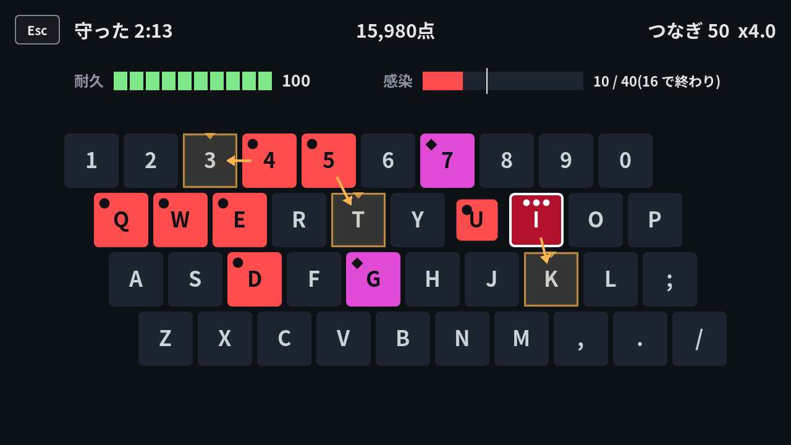
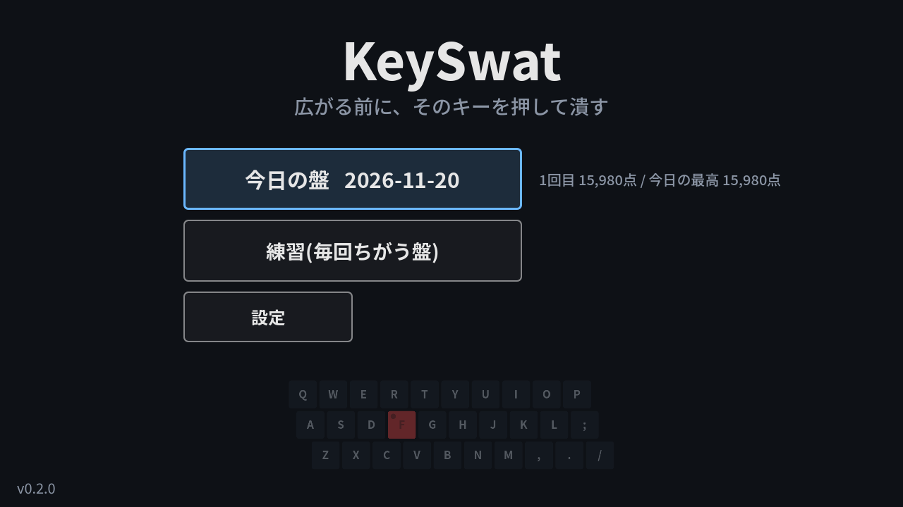
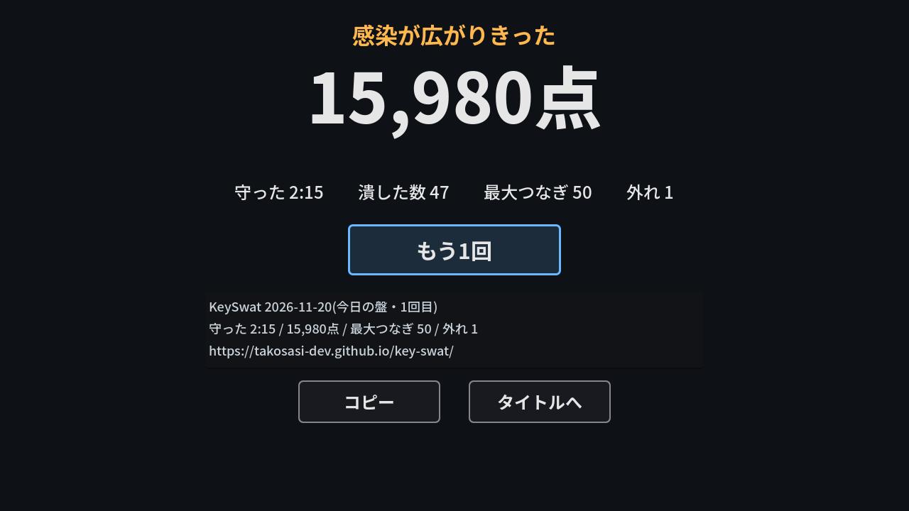

# KeySwat

画面のキーボードに虫が湧き、隣のキーへ広がっていきます。**広がる前に、そのキーを手元のキーボードで押して潰す**ゲームです。虫のいるキーが盤の 4 割に届くか、耐久が尽きると終わります。ブラウザで開くだけで遊べます。

**▶ 遊ぶ: https://takosasi-dev.github.io/key-swat/** (デスクトップの Chrome・Edge・Firefox。キーボードで遊びます。インストール不要)

> v0.2.0。人に遊んでもらう確かめはまだです。広がりの間隔や外れの重さなどの調整値は、仕様の初期値のままです。ブラウザでは、窓なしの Chrome で起動と一通りの流れまで確かめました。



| タイトル | 結果 |
|---|---|
|  |  |

## 遊び方

- 最初は F に虫が 1 匹います。F を押すと潰れて、時計が動き出します。
- 赤いキーを押すと潰れます。外さずに続けると「つなぎ」が伸び、点の倍率が上がります(最大 x4.0)。
- **虫のいないキーを押すと外れ**です。耐久が 8 減り、つなぎが切れます。全部のキーを手のひらで叩くと、すぐに耐久が尽きます。
- 虫は時間がたつと隣のキーへ広がります。広がる 0.5 秒前に、広がり先のキーの縁が橙に光り、元から矢印が出ます。その間に元を潰せば、広がりは起きません。
- 時間がたつと新しい物が 1 つずつ出ます。
  - 40 秒: **巣**(白い点 3 つ)。3 回押すと消えます。ふつうより速く広がります。
  - 80 秒: **数字の段**が盤に加わります。
  - 120 秒: **跳ぶ虫**(ひし形)。1 つ飛ばした先へ広がります。
- 終わりの時間はありません。守った時間と点を競います。
- Esc で一時停止。

| 見た目 | 中身 |
|---|---|
| 赤い四角に黒い丸 | ふつうの虫 |
| 濃い赤の四角に白い点(残りの数)と白い縁 | 巣 |
| 赤紫の四角に黒いひし形 | 跳ぶ虫 |
| 橙の縁と上の三角 | 次に広がる先 |
| 緑の輪 | 元を潰して、広がりを止めた |
| 画面の縁が赤い | 感染が 3 割を超えた(終わりが近い) |

盤のキーは、英字 26 と `;` `,` `.` `/`、後で数字の 10 キーです。キーは**位置**で取るので、JIS 配列でも US 配列でも、同じ位置のキーが盤の同じキーになります。

## 今日の盤

「今日の盤」は日付で決まり、同じ日なら誰でも同じ湧き方です。結果画面の文字をコピーして貼れば比べられます。「練習」は毎回ちがう盤です。

```
KeySwat 2026-11-19(今日の盤・1回目)
守った 2:41 / 12,400点 / 最大つなぎ 38 / 外れ 3
https://takosasi-dev.github.io/key-swat/
```

潰した時の点 = 10 × (10 + つなぎ(30 まで))。巣は 3 倍。

## しくみ

- **ゲームの決まりは `core/` にだけ**あります(配置と隣・湧く予定・広がり・潰す・外れ・点・負け)。画面は `sim.snapshot()` と `sim.events()` を読んで描くだけです。
- 1/120 秒刻みで進め、入力は盤の番号(整数)だけを受けます。同じ種と同じ入力なら同じ結果になることを、テストで確かめています。
- 40 キーの配置の表(段・列・刻印・物理キー・画面の位置と隣)は `core/layout.gd` の 1 か所にあります。
- テスト用の bot(虫だけを順に押す bot・手のひらで 4 つずつ叩く bot・何もしない bot)に遊ばせて、叩く打ち方が必ず損になることを確かめています。
- 保存はブラウザの中(localStorage の `key-swat/save`)だけです。サーバーとの通信やアクセス解析はありません。

## 動作環境

- Godot 4.7.2-stable(GDScript、レンダラー Compatibility)
- Web 書き出しはスレッド無し・拡張無し

## 開発

```
# テスト(全件成功で終了コード 0)
godot --headless --import
godot --headless --script res://tests/run_tests.gd

# Web 書き出し(書き出しテンプレート 4.7.2 が要る)
godot --headless --export-release "Web" build/web/index.html

# 窓なしで本体を動かし、S0 → 今日の盤 → 結果まで bot に通させる(Python)
python tools/gd.py smoke 3000 --auto=mash

# bot 3 種の守った時間を種 1〜10 で出す
python tools/gd.py run res://tools/bot_report.gd

# 字体を画面の文字に絞る・効果音を作る(Python)
pip install fonttools
python tools/subset_font.py
python tools/gen_sfx.py
```

ブラウザでの確かめ(Node.js 24 と Chrome。窓を出さず、音を消し、使い捨てのプロフィールで開きます):

```
# build/web を手元で配り、S0 → タイトル → 設定 → 今日の盤(bot が 2 分強守る)→ 一時停止 → 結果 → もう1回 → 練習 → 40 キー → 負荷の場面
# を通して、画面を build/web_shots/ に撮る(5 分ほど)。--docs で README の画像を docs/ に写す
node tests/web/check.mjs
# 公開した物を確かめる(状態の窓口 ?debug=1 を読む)
KS_URL=https://takosasi-dev.github.io/key-swat/ node tests/web/check.mjs --quick
```

`tools/gd.py` は環境変数 `GODOT` の Godot を `--headless` で呼びます。`main` に push すると、GitHub Actions がテスト → Web 書き出し → GitHub Pages への配置を行います(`.github/workflows/pages.yml`)。

公開 URL に `?keys=1` を付けて開くと、押したキーの中身(`physical_keycode` など)を文字で出す確かめの画面になります(Esc 2 回でタイトルへ)。

## 開発状況

- v0.2.0。仕様の画面・決まり・保存・共有の文字・設定・一時停止は全部入っています。テスト 69 件が通ります。
- 窓なしの Chrome(デスクトップ版 Chrome を `--headless=new` で動かし、キーは CDP で本物のキーとして送る)で確かめたこと: 起動して S0 が出るまで(手元で配って 5 秒ほど)、S0 → タイトル → 設定 → 今日の盤 → 一時停止(Esc とタブが裏に回った時)→ 結果 → もう1回 → 練習、40 キーの位置(`physical_keycode`)、保存が `key-swat/save` に入り ParryDuel の保存を消さないこと、読み込みの後の通信 0 件、コンソールのエラー 0 件、揺れを切ると画面が動かないこと。
- まだ確かめていないこと: 人が遊んだ手触りと調整値、本物のキーボード(JIS・US)での位置、日本語入力がオンの時、Edge・Firefox、音を耳で聞くこと。
- 撤退基準: R-3(手のひらで叩く bot が、虫だけを押す bot より長く生き残る種がある)は判定済みで、当たらない(種 1〜10 で連打 bot は 0.4 秒以内に負け、正しい bot は 5 分の打ち切りまで負けない)。R-1(遊んだ人が続けて「もう1回」を押すか)・R-2(本物のキーボードとブラウザで 40 キーが正しい位置で届くか)・R-4(遊んだ人の説明)は未判定です。

## ライセンス

MIT(`LICENSE`)。同梱の字体は SIL Open Font License 1.1 です(`THIRD-PARTY-NOTICES.md`)。
